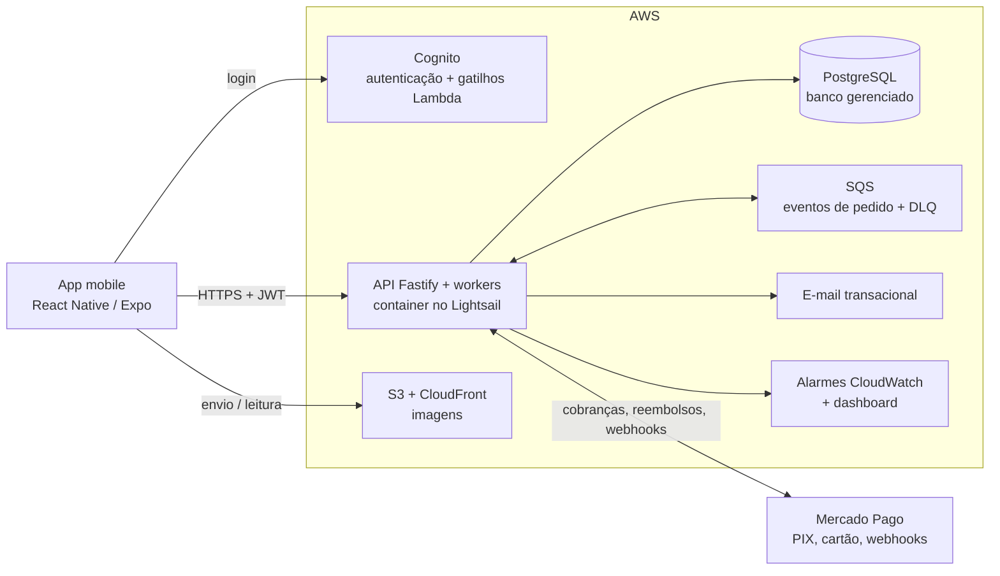

# Ybá · Delivery de feira livre, do app à nuvem

Marketplace de dois lados que permite comprar produtos frescos das bancas de feira livre do bairro, pagar com PIX e receber em casa ou retirar na banca. Construí o app mobile, o backend e a infraestrutura na AWS como único desenvolvedor do projeto na Kavicki.

**Links:** [App Store](https://apps.apple.com/br/app/yba-feira-em-casa/id6762023962) · [Site](https://ybapp.com.br)

> Este repositório é um estudo de caso, não um repositório de código. O código-fonte pertence ao cliente e continua privado. Tudo o que está aqui descreve o meu próprio trabalho, em um nível de detalhe que posso aprofundar em entrevista.

---

## Visão geral

| | |
|---|---|
| **Meu papel** | Único desenvolvedor: app mobile, backend, banco de dados, infraestrutura em nuvem e publicação na App Store |
| **Período** | Maio a outubro de 2026 |
| **Status** | Publicado na App Store (v1.0.1, outubro de 2026), em piloto fechado com bancas convidadas e dinheiro real |
| **Stack** | React Native / Expo, TypeScript, Node.js / Fastify, PostgreSQL, AWS (CDK, Lightsail, Cognito, S3, CloudFront, SQS, SES, Lambda, Secrets Manager, CloudWatch), Mercado Pago (PIX e cartão) |
| **Código** | 18 módulos de domínio no backend · 66 migrations SQL · mais de 4.600 casos de teste automatizados |

## O problema

A feira livre é onde muitas famílias brasileiras compram comida fresca, mas ela é offline por natureza: não tem catálogo, não dá para consultar preço antes de sair de casa e não tem como fazer pedido. Os feirantes são pequenos vendedores, com pouco tempo e celulares simples.

O Ybá precisava funcionar para os dois lados:

- **Compradores** encontram as feiras próximas no mapa, navegam por cada banca, montam o carrinho, pagam com PIX ou cartão e acompanham o pedido.
- **Feirantes** gerenciam produtos vendidos por quilo ou por unidade, aceitam ou recusam pedidos, confirmam a entrega com um código e sacam o que ganharam para a chave PIX.

Como dinheiro real passa pela plataforma, estar correto importava mais do que ter muitas funcionalidades. Um pedido pago nunca pode se perder, o estoque não pode ser vendido além do que existe e cada centavo na carteira do feirante precisa ter explicação.

## Restrições

- **Um único desenvolvedor** para app mobile, backend, infraestrutura e publicações.
- **Orçamento fixo de infraestrutura** combinado com o cliente para o piloto.
- **Dinheiro real desde o primeiro dia.** O piloto roda com pagamentos reais por PIX e cartão, então os fluxos de pagamento e carteira nunca podiam falhar em silêncio.
- **Feirantes com celulares simples e pouco tempo.** Cadastro, catálogo e gestão de pedidos precisavam ser rápidos de usar na banca.
- **Textos legais aprovados pelos advogados do cliente.** Termos do consumidor, termos do vendedor e política de privacidade ficam dentro do app e são versionados, e o aceite do vendedor é registrado.

## O que construí

**App mobile (um app, duas personas)**
- Fluxo do comprador: mapa de feiras (Mapbox) construído sobre dados abertos das feiras livres de São Paulo, vitrines, carrinho, checkout PIX com contagem regressiva do QR, pagamento com cartão, acompanhamento do pedido e chat com o vendedor.
- Fluxo do feirante: cadastro com aprovação, catálogo com unidades de venda, estoque, fila de pedidos, confirmação de entrega por QR, carteira, extrato e saques.
- Camada de dados com TanStack Query e cache persistido, notificações push e autenticação com Cognito.

**Backend**
- API em Fastify e TypeScript sobre PostgreSQL, organizada em módulos de domínio (pedidos, pagamentos, carteira, estoque, catálogo, descoberta, identidade, notificações, suporte e outros).
- Workers em segundo plano para expiração de pedidos, eventos de pedido, reembolsos e saques.
- Integração com Mercado Pago: cobranças PIX e cartão com chaves de idempotência, confirmação por webhook, conciliação e reembolsos.
- Ledger de carteira para os feirantes: créditos de pedidos pagos, reembolsos, saques com tarifa e estados explícitos (solicitado, em processamento, concluído, recusado, em análise).

**Infraestrutura**
- Infraestrutura na AWS como código com CDK, dividida nas stacks de fundação, plataforma, observabilidade e controle de custo.
- API e banco no Lightsail, com custo mensal fixo (ver [ADR 0001](docs/adr/0001-migrar-computacao-para-lightsail-por-custo-fixo.md)).
- Scripts de deploy versionados por ambiente e builds no EAS com versionamento remoto para o app.

## Arquitetura

- O app autentica no Cognito e chama a API com um JWT que o backend verifica em toda requisição.
- O checkout grava o pedido, reserva o estoque e registra a intenção de pagamento antes de entregar o QR do PIX ao comprador. O webhook do Mercado Pago, identificado pelo id do pedido, é a única fonte de verdade para "pago".
- Os eventos de pedido passam pelo SQS com uma fila de mensagens mortas (DLQ). Expirações, reembolsos e saques rodam como workers em segundo plano.
- As imagens vão para o S3 e são servidas pelo CloudFront.
- Alarmes do CloudWatch monitoram a idade da fila de eventos de pedido e a taxa de rejeição de e-mails.

## Principais decisões e trade-offs

| Decisão | Alternativas consideradas | Por quê | Custo aceito |
|---|---|---|---|
| Migrar API e banco de ECS Fargate, ALB e RDS para Lightsail ([ADR 0001](docs/adr/0001-migrar-computacao-para-lightsail-por-custo-fixo.md)) | Manter Fargate e RDS | Custo mensal fixo e previsível, compatível com o que o cliente aprovou | O Lightsail não tem suporte de primeira classe no CDK, então é gerenciado por scripts versionados. O container usa chave de usuário IAM em vez de role |
| Manter o Ybá como intermediador financeiro, com carteira e saques próprios ([ADR 0002](docs/adr/0002-carteira-e-saques-em-vez-de-split-de-marketplace.md)) | Split de marketplace do Mercado Pago, com OAuth por vendedor | Mantém carteira, extrato e tarifas dentro do app, sem cadastro externo para o feirante | A conta da plataforma precisa ter saldo suficiente, e os saques exigem requisições assinadas |
| Validade do QR PIX igual ao mínimo de 30 minutos do provedor ([ADR 0003](docs/adr/0003-alinhar-validade-do-pix-ao-minimo-do-provedor.md)) | Validade de 10 minutos com reembolso automático de pagamentos atrasados | Um QR que expira junto com o pedido torna o pagamento atrasado impossível, então não é preciso um fluxo de reembolso | O comprador tem uma janela maior do que a planejada no início |
| Reserva de estoque opcional ([ADR 0004](docs/adr/0004-reserva-de-estoque-opcional.md)) | Controlar o estoque de todo produto, ou não controlar nenhum | Impede venda acima do estoque para quem conta o estoque, sem obrigar quem não conta | Mais transições de estado para acertar |
| Testes de contrato contra PostgreSQL e um backend em memória ([ADR 0005](docs/adr/0005-testes-de-contrato-com-dois-backends.md)) | Só testes com banco, ou só mocks | Retorno rápido a cada mudança, com a prova de que o SQL se comporta igual | Duas implementações de cada store precisam ficar em paridade |

## Desafios

**Um checkout que nunca deixa um pedido pago preso como não pago.** Antes do piloto, mapeei todos os caminhos de falha do checkout, que envolvia quatro passos: gravar o pedido, criar a cobrança PIX, registrar o pagamento e limpar o carrinho. O caso crítico era este: se algo falhasse depois de criar a cobrança e antes de salvar o registro do pagamento, o webhook do provedor não teria com o que casar, e o dinheiro do comprador ficaria parado em um pedido que nunca sairia de "aguardando pagamento". A parte difícil é que a cobrança é uma chamada HTTP externa, então nunca pode entrar em uma transação de banco. Redesenhei o checkout em duas unidades atômicas (o pedido com seus itens, depois o registro do pagamento junto com a limpeza do carrinho), mantive a chamada ao provedor idempotente pelo id do pedido e adicionei uma rotina que move pedidos abandonados e não pagos para um novo estado de "pagamento expirado". Tudo foi escrito com testes primeiro, antes de o piloto movimentar dinheiro real.

**Configuração blindada por ambiente.** Antes do go-live, isolei a configuração de cada ambiente para que um deploy de produção nunca subisse com pagamentos de demonstração ligados: cada ambiente tem o próprio arquivo, o deploy falha quando ele não existe e o backend se recusa a iniciar com configurações de pagamento conflitantes.

## Do design ao código

Recebo o design visual no Figma e o design system do Ybá prontos da equipe de design da Kavicki, e transformo isso no produto. Cada tela é construída somente com componentes e tokens do design system, e depois comparada com a referência do Figma no app rodando antes de ser considerada pronta. Divergências visuais são corrigidas, não aceitas.

## Como trabalho

Fui dono deste produto de ponta a ponta. Transformei as necessidades do cliente em especificações, projetei a arquitetura e o modelo de dados, tomei as decisões de segurança e de custo de infraestrutura e levei o app até a App Store.

Meu processo foi montado para manter a qualidade alta entregando como único desenvolvedor:

- **Especificação primeiro.** Toda funcionalidade começa com um documento de design e um plano de implementação que eu defino e aprovo. Este projeto tem mais de 80 deles, além de registros de decisão e runbooks operacionais (go-live, reembolsos e saques em análise). Eles fixam escopo, invariantes e casos de borda antes de existir qualquer código.
- **Testes como rede de segurança.** Mais de 4.600 casos de teste automatizados: cerca de 2.800 no backend, 1.700 no app, 110 nos schemas compartilhados e 40 na infraestrutura. Os fluxos que envolvem dinheiro são escritos com testes primeiro, e os testes de contrato obrigam o SQL a se comportar igual ao backend em memória.
- **Uma só linguagem para o domínio.** Um glossário fixa os termos financeiros (carteira, saldo disponível, saque, repasse, valor líquido), e schemas de validação compartilhados mantêm o app e a API de acordo.
- **Falha explícita, nunca silenciosa.** O backend se recusa a iniciar com segredos fracos ou com dois modos de saque conflitantes ligados ao mesmo tempo.
- **Assistido por IA, sob minha responsabilidade.** Uso agentes de código para acelerar a implementação de tarefas que já defini. Reviso cada diff, rejeito o que não segue o design e mantenho arquitetura, modelagem de dados, segurança e lógica de pagamento sob meu controle direto.
- **Operação segura.** Mudanças de infraestrutura são planejadas em um documento de design e aplicadas passo a passo, com aprovação manual antes de qualquer ação cobrada ou destrutiva.

## Resultados

- Publicado na App Store em outubro de 2026, com piloto fechado e pagamentos reais.
- Custo de infraestrutura passou de variável para fixo (cerca de R$ 170 por mês) sem nenhuma mudança no app.
- Fluxo de pagamento protegido contra as falhas que perdem dinheiro: pedidos gravados pela metade, pedidos pagos presos como não pagos, pagamentos PIX atrasados e venda acima do estoque.

## Próximos passos

- Ambiente de produção dedicado para a expansão além do piloto.
- Caminho de escala já mapeado: a API é um container sem estado e o schema está inteiro nas migrations, então voltar para Fargate e RDS é uma mudança conhecida.
- O modelo de intermediação está isolado atrás de configuração, pronto para migrar para split de marketplace se o cliente mudar a posição comercial.

## Equipe e créditos

- **Design system:** fornecido pronto para uso pela equipe de design da Kavicki. Construí o app inteiro sobre ele, da primeira tela até a publicação na loja: todas as telas e fluxos, navegação, estado e camada de dados, integrações, backend e infraestrutura.
- **Produto:** prioridades e regras de negócio foram definidas junto com o cliente.

## Por que não há código aqui

O código pertence ao cliente. Em uma entrevista técnica, posso percorrer qualquer parte do sistema, incluindo modelos de dados, fluxos de pagamento e infraestrutura, dentro dos limites desse acordo.

---

Contato: [LinkedIn](https://www.linkedin.com/in/gabriel-souza-fernandes/) · [GitHub](https://github.com/Fergab1)
